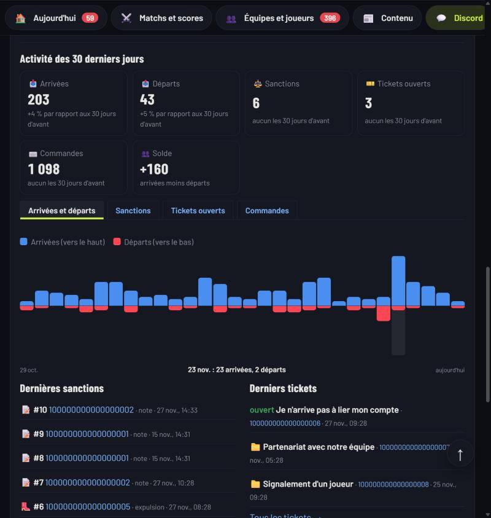
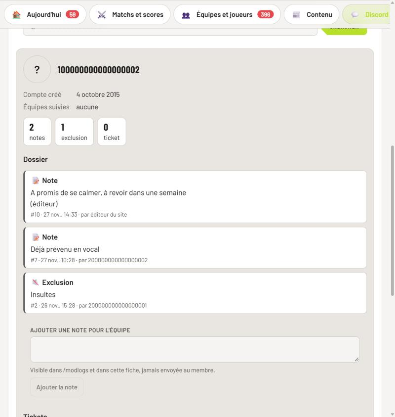
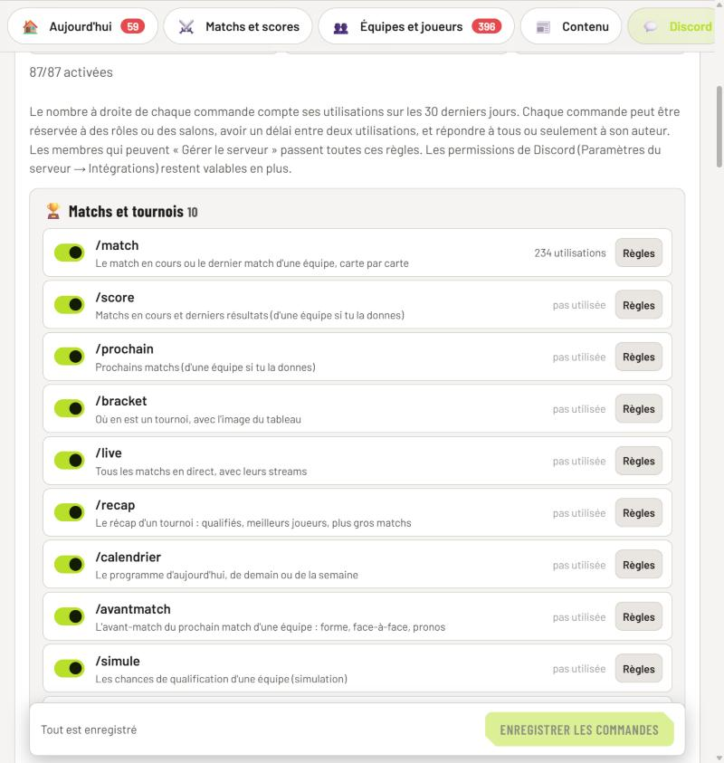
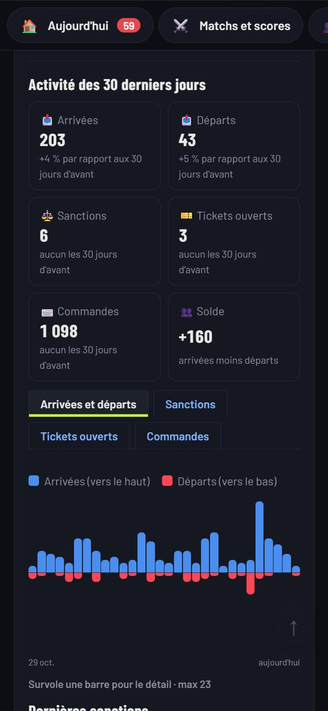

# Proposition : tableau de bord du bot, deuxième étape

Branche `bot-dashboard-2`, partie de `main` (7c47368, le premier tableau de bord déjà en ligne). Poussée seule : **rien n'est en ligne**.

## Ce qui change

### 1. L'accueil montre l'activité du serveur

Sous les cartes des modules, un bloc « Activité des 30 derniers jours » :

- **six chiffres** : arrivées, départs, sanctions, tickets ouverts, commandes utilisées, et le solde (arrivées moins départs). Chacun est comparé aux 30 jours d'avant (« +4 % par rapport aux 30 jours d'avant ») ;
- **un graphique par jour**, avec quatre onglets : arrivées et départs (les arrivées vers le haut en bleu, les départs vers le bas en rouge), sanctions, tickets, commandes. Survoler ou toucher une barre affiche le détail du jour ;
- **les 6 dernières sanctions et les 5 derniers tickets**, avec un lien vers leurs pages.

Les arrivées et départs n'étaient pas gardés jusqu'ici : le bot les compte jour par jour **à partir de cette version**. L'accueil indique depuis quand.

### 2. Une fiche par membre (nouvelle page « 👤 Membres »)

- **Recherche** par pseudo, par @mention ou par identifiant. Si plusieurs pseudos correspondent, l'éditeur propose une liste avec les avatars.
- **Ce que réunit la fiche** :
  - son état : sur le serveur, exclu jusqu'à telle heure, banni, ou parti ;
  - la date de création du compte et la date d'arrivée sur le serveur ;
  - les équipes qu'il suit avec le bot ;
  - ses sanctions comptées par type, et celles en cours ;
  - son **dossier complet** (avertissements, exclusions, bans, notes), du plus récent au plus ancien ;
  - ses tickets.
- **Ajouter une note pour l'équipe** depuis la fiche. Elle va dans le même dossier que `/note` et se voit dans `/modlogs`. Elle n'est jamais envoyée au membre.
- **Le nom d'un membre ouvre sa fiche** partout où il apparaît : dans l'accueil, le tableau des sanctions et la liste des tickets.

### 3. La page « Commandes » montre l'utilisation de chaque commande

- À droite de chaque commande : son nombre d'utilisations sur 30 jours, ou « pas utilisée ». Les commandes groupées (`/warn`, `/role`, `/ticket`) additionnent leurs sous-commandes.
- Un nouveau choix d'ordre : « Les plus utilisées d'abord », ou « Jamais utilisées (30 j) » pour repérer celles à désactiver.

Sur téléphone, les chiffres passent sur deux colonnes et le graphique tient dans l'écran :

## Testé

- **4 nouveaux tests** (`tests/botactivity.test.mjs`) :
  - arrivées et départs comptés par les événements du serveur, sans les bots ni les autres serveurs ;
  - 30 jours comparés aux 30 d'avant (les notes ne comptent pas comme sanctions, les clics de pronostic pas comme commandes) ;
  - identifiant lu depuis une mention ou un lien, date de création du compte, fiche d'un membre ;
  - utilisations par commande telles que l'éditeur les montre.
- **341 tests passent, build vert.**
- **Éditeur local** sur la copie de base, avec 60 jours d'activité fictive, sur ordinateur et téléphone, en sombre et en clair :
  - les onglets du graphique et le détail au survol ;
  - le clic sur un nom qui ouvre la fiche ;
  - la recherche par mention ;
  - l'ajout d'une note ;
  - le tri des commandes par utilisation.
- **Couleurs du graphique** : bleu et rouge, vérifiées avec un outil de contrôle des couleurs pour rester distinctes pour les daltoniens, dans les deux thèmes. Le haut et le bas les distinguent aussi.

## Pas testé

- **Avec un vrai serveur Discord** (pas de jeton en local) : la recherche par pseudo, l'avatar, l'état « exclu », « banni » ou « parti », et la date d'arrivée viennent de Discord. En local, la fiche montre l'identifiant et ce que le bot a gardé lui-même.

## Après la mise en ligne

Rien à refaire sur Discord : pas de nouvelle commande ni de nouveau droit. L'intent Server Members, déjà demandé, sert aux arrivées et départs.
