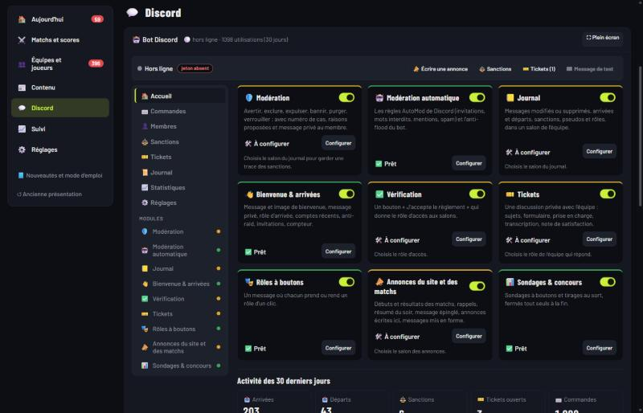
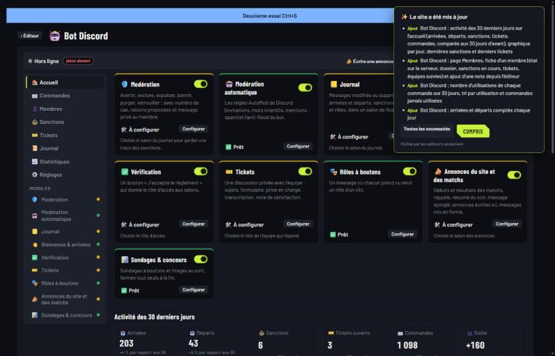
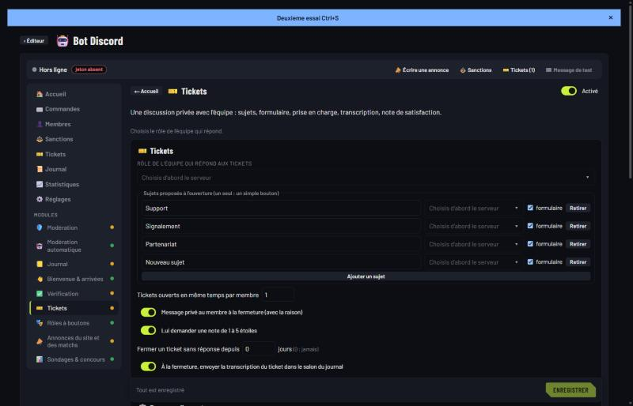

# Proposition : le tableau de bord du bot toujours ouvert, et sur sa propre page

Branche `bot-dashboard-3`, partie de `main` (c808f14). Poussée seule : **rien n'est en ligne**.

## Ce qui change

### Plus besoin de cliquer pour l'ouvrir

Dans l'éditeur (Discord), le tableau de bord du bot n'est plus une barre repliée : **il s'affiche directement**. En haut, à droite, un bouton **« ⛶ Plein écran »** ouvre la page où tu te trouves sur sa propre page.

### Une page à part : `/admin/bot`

- **Toute la largeur de l'écran** pour le tableau de bord, avec un lien « ‹ Éditeur » pour revenir.
- **Chaque page a son adresse**, par exemple `/admin/bot?p=members` pour les membres ou `/admin/bot?p=mod:tickets` pour le module Tickets. On peut la garder en favori, l'envoyer à un autre éditeur, ou utiliser les boutons « retour » et « suivant » du navigateur.
- Réservée aux éditeurs connectés, comme le reste de l'éditeur.

### Un menu sur le côté, comme les tableaux de bord des bots connus

- Quand il y a la place (écran d'ordinateur), les pages sont dans un **menu à gauche**, qui reste visible en faisant défiler : Accueil, Commandes, Membres, Sanctions, Tickets, Journal, Statistiques, Réglages.
- En dessous, la rubrique **« Modules »** liste les 9 modules, chacun avec une pastille d'état : vert pour prêt, orange pour à configurer, rouge pour un droit manquant, vide pour désactivé. On ouvre ainsi un module en un clic, depuis n'importe quelle page.
- **Sur téléphone**, ou dans une colonne étroite, le menu redevient la barre d'onglets qui défile.

## Testé

- **341 tests passent, build vert.**
- **Éditeur local**, sur une copie de la base :
  - le tableau de bord ouvert d'office dans l'éditeur ;
  - le bouton « Plein écran » ;
  - la page `/admin/bot` ouverte directement sur `?p=members` ;
  - l'adresse qui change à chaque page ;
  - les boutons « retour » et « suivant » ;
  - l'ouverture d'un module depuis le menu ;
  - sur grand écran (1400 px) et sur téléphone (375 px, sans débordement).

## À savoir

- Le tableau de bord se charge **dès l'ouverture de l'éditeur**, alors qu'avant il attendait le clic. Il lit alors Discord une fois : serveurs, salons, rôles, droits du bot. C'est la même lecture qu'avant, simplement plus tôt.
- Rien à refaire sur Discord.
