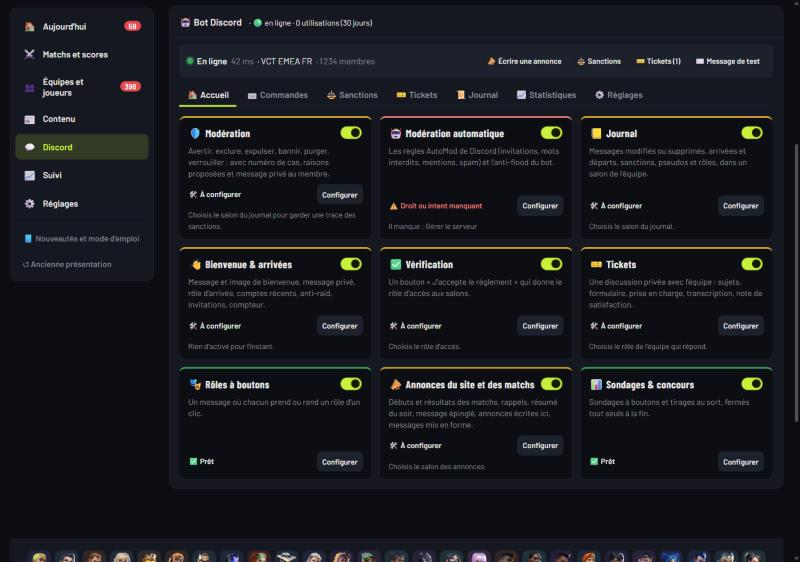
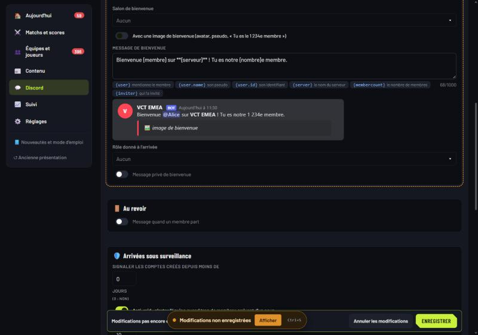
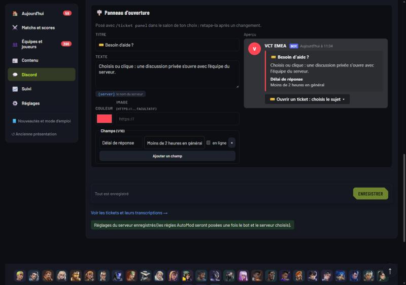
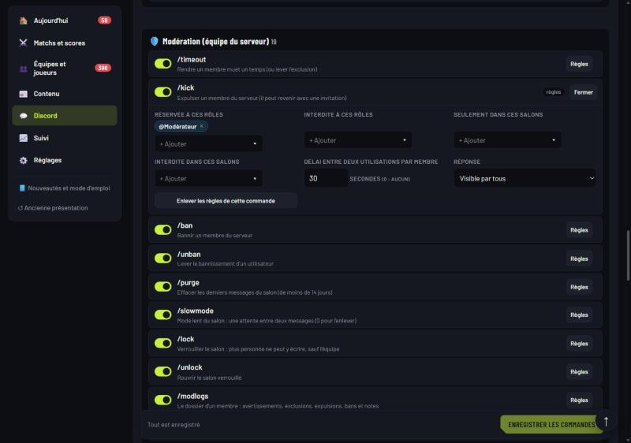
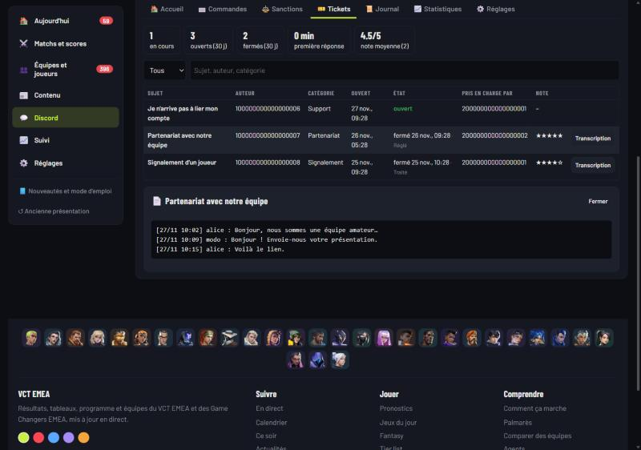
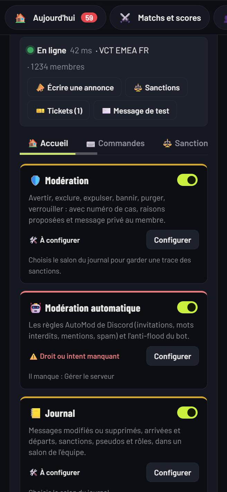
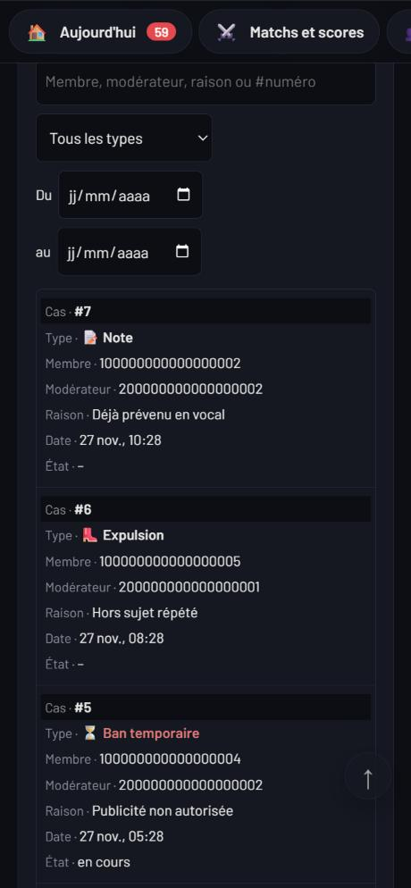
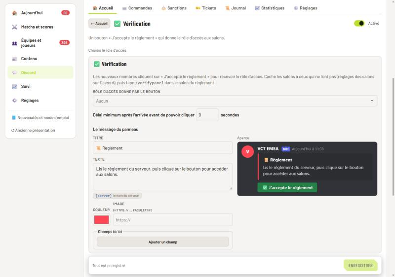

# Proposition : un vrai tableau de bord pour le bot, et des commandes mieux rangées

Branche `bot-dashboard`, partie de `main` (08fe382) et poussée seule. **Rien n'est en ligne.**

L'organisation s'inspire des bots connus (modules qu'on active, page par commande, tableau des sanctions, éditeur de messages avec aperçu). L'apparence reste celle du site : aucun nom, logo ni couleur repris.

## Le tableau de bord (éditeur → Discord → Bot Discord)

- **Barre d'état** visible sur toutes les pages : en ligne ou non, latence de la connexion en ms, nom du serveur, nombre de membres. Raccourcis : enregistrer les commandes (s'il en manque), écrire une annonce, sanctions, tickets ouverts, message de test.
- **Accueil en modules**, une carte chacun :
  - Modération, Modération automatique, Journal ;
  - Bienvenue & arrivées, Vérification, Tickets ;
  - Rôles à boutons, Annonces du site et des matchs, Sondages & concours.
- **Ce que montre chaque carte** : un interrupteur, une phrase d'explication, un bouton « Configurer », et un état parmi les suivants :
  - ✅ prêt ;
  - 🛠️ à configurer (en disant quoi) ;
  - ⚠️ droit ou intent manquant (en disant lequel, d'après les vrais droits du bot sur le serveur) ;
  - ⏸️ désactivé.
- **Un module désactivé** refuse ses commandes et ses boutons avec un message clair. L'AutoMod retire ses règles, le journal et la bienvenue s'arrêtent, et les annonces automatiques ne partent plus.
- **Une page par module**, réglages groupés. Les salons et rôles se choisissent dans une liste lue depuis Discord, avec une recherche ; les rôles ont leur couleur. Il n'y a plus d'identifiant à copier.
- **Éditeur de messages** pour la bienvenue, l'au revoir, le message privé et les annonces :
  - variables cliquables : `{user}`, `{user.name}`, `{user.id}`, `{server}`, `{membercount}`, `{inviter}` ;
  - les anciennes `{membre}`, `{pseudo}`, `{serveur}` et `{nombre}` marchent toujours ;
  - **aperçu en direct qui ressemble à un message Discord**.

  
- **Constructeur d'embed** (titre, texte, couleur, image, jusqu'à 10 champs, aperçu en direct). Il sert pour le panneau des tickets, le panneau de vérification, les annonces et les **messages préparés que `/embed template:` publie**.

  
- **Page « Commandes »** : toutes les commandes par catégorie, avec une recherche. Chacune peut être :
  - activée ou désactivée ;
  - réservée à des rôles, ou interdite à des rôles ;
  - permise seulement dans certains salons, ou interdite dans certains salons (les fils suivent leur salon) ;
  - soumise à un délai entre deux utilisations par membre ;
  - réglée sur une réponse « visible par tous » ou « seulement par l'auteur ».

  Les membres qui peuvent « Gérer le serveur » passent ces règles. Le tableau des commandes renommées est en bas de la page.

  
- **Page « Sanctions »** :
  - tableau des cas, avec une recherche par membre, modérateur, raison ou `#numéro`, par type et par dates ;
  - détail d'un cas, raison modifiable ;
  - **révocation** : débannir, lever l'exclusion, retirer l'avertissement. La raison va dans le journal d'audit de Discord, le journal du bot et le salon du journal.
- **Page « Tickets »** :
  - liste des tickets, ouverts ou fermés, avec le sujet, l'auteur, la catégorie, qui l'a pris en charge, la note et la raison de fermeture ;
  - **lecture de la transcription dans l'éditeur** ;
  - statistiques sur 30 jours.

  
- **Page « Journal »** : les derniers événements, filtrés par type, par mot ou par erreurs seulement.
- **Pages « Statistiques » et « Réglages »** : serveur, langue, enregistrement des commandes, lien des droits.
- **Utilisable sur téléphone** : les tableaux passent en fiches, le menu défile.

    

## Les commandes sur Discord

- **Réponses homogènes** : les commandes de modération, de gestion et de tickets répondent par un embed coloré selon le type.
  - Couleurs : vert pour un succès, rouge pour une erreur, orange pour une sanction (avec le **numéro de cas** et l'heure relative), jaune pour « patiente ».
  - Les fins d'exclusion sont aussi en relatif (« dans 2 heures »).
- **Erreurs claires** :
  - « Permission manquante : il te faut « Bannir des membres » » ;
  - « Ce membre a un rôle égal ou supérieur au tien » ;
  - « Ce membre n'est pas sur le serveur » ;
  - « Le module Tickets est désactivé » ;
  - « Cette commande est réservée à @Modérateur » ;
  - « Attends encore un peu : tu pourras la refaire dans 25 secondes ».
- **`/help`** (et `/aide`) : un menu déroulant des catégories. Chaque commande y a sa description et un exemple, par exemple `/warn add user:@membre reason:Spam`.
- **Sous-commandes groupées**, comme le font les bots connus. Elles passent par les mêmes vérifications (permissions, ordre des rôles, journal d'audit, journal du bot) que les commandes qu'elles remplacent.
- **Autocomplétion** :
  - raisons (celles de l'éditeur) et durées (`10m`, `1h`, `1d`…) dans toutes les sous-commandes ;
  - **sujets de ticket** dans `/ticket open subject:` ;
  - **messages préparés** dans `/embed template:`.

### Ancien → nouveau

| Avant | Maintenant |
|---|---|
| `/warn user reason` | `/warn add user reason` |
| `/warnings user` | `/warn list user` |
| `/unwarn id` | `/warn remove id` |
| `/clearwarns user` | `/warn clear user` |
| `/addrole user role` | `/role add user role` |
| `/removerole user role` | `/role remove user role` |
| `/ticket subject` | `/ticket open subject` |
| `/close reason` | `/ticket close reason` (et **`/close` reste**, comme sur Ticket Tool) |
| `/add`, `/remove`, `/rename`, `/claim`, `/priority` | `/ticket add`, `/ticket remove`, `/ticket rename`, `/ticket claim`, `/ticket priority` |
| `/ticketpanel` | `/ticket panel` |
| `/role role:` (meilleurs joueurs d'un rôle, côté site) | `/meilleurs role:` (`/role` sert maintenant aux rôles du serveur) |
| — | `/help` (nouveau, comme `/aide`) |
| `/embed text:` | `/embed text:` ou **`/embed template:`** |

Le total passe de 96 à **87 commandes** (82 commandes « / » et 5 menus clic droit), sous la limite de 100 de Discord. Les autres commandes ne changent pas : `/kick`, `/ban`, `/tempban`, `/timeout`, `/purge`, `/lockdown`, `/case`, `/reason`, `/modlogs`, `/note`…

## Testé

- **11 nouveaux tests avec le faux Discord** (`tests/botdash.test.mjs`) :
  - sous-commandes (noms, permissions, exécution, une permission manquante) ;
  - modules (refus, état des cartes) ;
  - règles par commande (rôles, salons, fils, délai, passe-droit des gérants) ;
  - couleurs des réponses ;
  - menu de `/help` ;
  - variables et embeds ;
  - `/embed template` et `/verifypanel` ;
  - modules coupés sur les événements du serveur ;
  - tableau des sanctions et révocations (audit compris) ;
  - tickets et journal filtré.
- **Les anciens tests** sont mis à jour pour l'aide en menu, les sous-commandes et le nouveau message de permission. **337 tests passent, build vert.**
- **Éditeur local** sur une copie de la base, avec des sanctions et tickets fictifs, sur ordinateur et téléphone, en sombre et en clair :
  - les cartes et leurs états ;
  - la recherche dans un sélecteur ;
  - l'aperçu du message de bienvenue ;
  - l'ajout d'un champ d'embed ;
  - l'enregistrement d'une règle de commande (rôle, 30 s, visible par tous) ;
  - le détail d'un cas et la transcription d'un ticket ;
  - le filtre « erreurs » du journal.
- Pour remplir les sélecteurs, des salons et rôles fictifs étaient injectés **dans le navigateur seulement** : sans jeton réel, l'éditeur local ne lit pas Discord.

## Pas testé

- **Un vrai serveur Discord** (pas de jeton) : ni le vrai menu de `/help`, ni les sous-commandes dans le client Discord, ni les vraies révocations, ni la latence réelle.
- **Les noms des membres** dans les tableaux : ils viennent de Discord avec le jeton. En local, on voit les identifiants.
- **Le délai entre deux utilisations** est gardé en mémoire : il repart à zéro au redémarrage du site.

## Ce que l'utilisateur doit refaire sur Discord après la mise en ligne

1. **Enregistrer les commandes** : éditeur → Discord → Bot Discord, bouton « ⬆️ Enregistrer les commandes ». Les anciennes (`/warnings`, `/addrole`, `/ticketpanel`…) disparaissent et les groupées apparaissent. Discord met parfois quelques minutes à rafraîchir la liste.
2. **Retaper `/ticket panel`** (ex-`/ticketpanel`) et `/verifypanel` pour poser les panneaux faits dans le constructeur. Les anciens panneaux continuent de marcher.
3. **Prévenir l'équipe de modération** des nouveaux noms (tableau ci-dessus) ; `/help` les montre aussi.
4. **Vérifier les cartes de l'accueil** : chaque carte « ⚠️ droit manquant » dit quel droit donner au rôle du bot. Le bouton « Donner ces droits au bot » est dans Réglages.
5. Rien à changer côté intents : les mêmes qu'avant (Server Members, Message Content).
6. **Facultatif** :
   - régler les règles de commandes (salons ou rôles réservés, délais) dans la page « Commandes » ;
   - préparer des messages pour `/embed template:` (module Annonces → « Messages préparés »).
