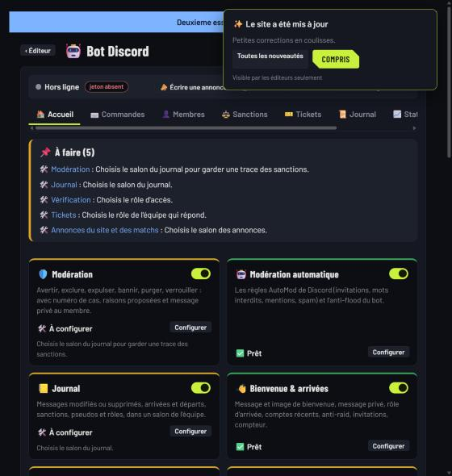
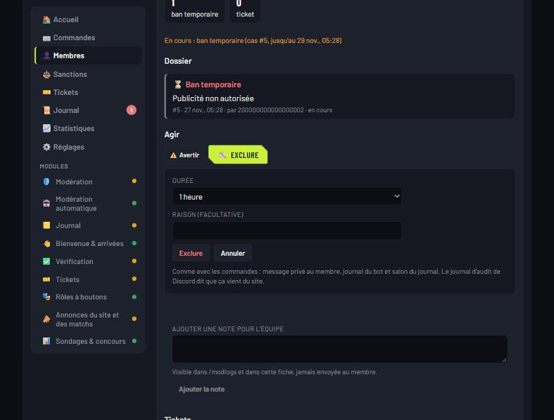
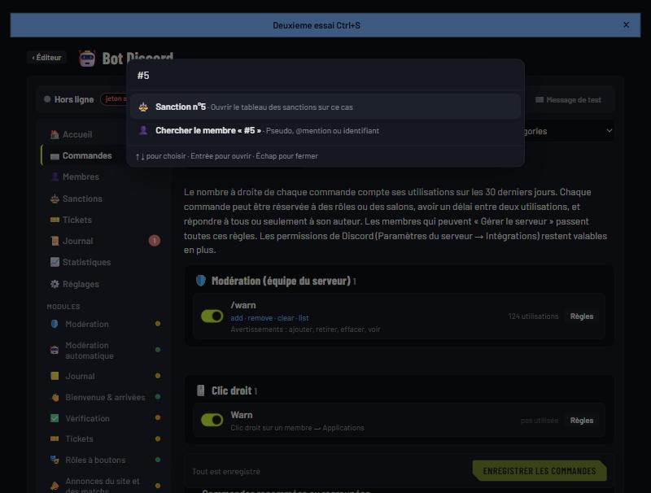
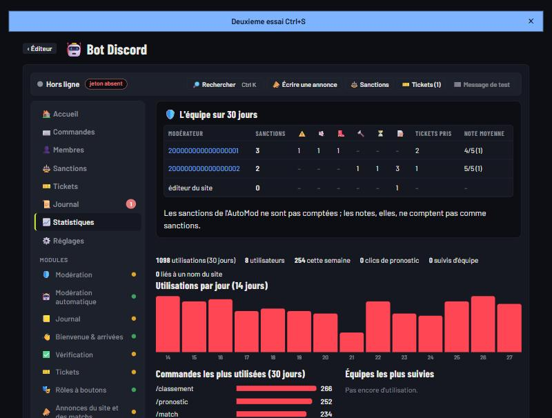

# Proposition : la suite du bot (pendant ton absence)

Branche `bot-suite`, partie de `main` (571d5db, déjà en ligne). Poussée seule : **rien n'est en ligne**. Mettre en ligne redéploie le site public, donc c'est toi qui décides.

## 1. Les délais des commandes ne repartent plus à zéro

Le délai entre deux utilisations d'une commande (page « Commandes » → Règles) était gardé en mémoire : chaque redémarrage du site l'effaçait, et un membre pouvait refaire la commande tout de suite. Il est maintenant **gardé en base**. Les délais finis depuis plus d'un jour sont effacés de temps en temps.

## 2. Réponses enregistrées pour les tickets

- Dans le module **Tickets**, une nouvelle rubrique « 💬 Réponses enregistrées » : un titre et un texte, 20 au plus.
- Dans le panneau d'un ticket ouvert, une liste « 💬 Réponse enregistrée… » au-dessus de la zone de réponse met le texte dans la réponse. Si quelque chose est déjà écrit, le texte s'ajoute à la suite. On peut retoucher avant d'envoyer.

## 3. Membres à surveiller

Sur la page **Membres**, avant toute recherche : la liste de ceux qui ont **une sanction en cours** (exclusion, bannissement) ou **au moins 2 avertissements sur 30 jours**. Les sanctions en cours passent en premier. Un clic ouvre la fiche du membre.

## 4. Sanctions : chiffres et export

Au-dessus du tableau des sanctions, pour ce qui est affiché (donc avec les filtres) :

- le nombre de cas ;
- le compte **par type** et **par modérateur** ;
- un bouton **« ⬇️ Exporter (CSV) »** qui télécharge le tableau, lisible dans Excel ou LibreOffice : cas, type, membre et son identifiant, modérateur, raison, dates, état.

## Testé

- **3 nouveaux tests** (`tests/botsuite.test.mjs`) :
  - un délai qui tient après un « redémarrage » (mémoire vide), sans bloquer un autre membre ;
  - les réponses enregistrées sans titre ou sans texte écartées, 20 au plus ;
  - la liste des membres à surveiller : avertissements trop anciens et exclusions finies écartés, sanctions en cours d'abord.
- **348 tests passent, build vert.**
- **Éditeur local** (copie de base), vérifié en lisant le contenu des pages, parce que les captures du volet ne se rafraîchissaient plus :
  - la liste des membres à surveiller (3 membres) ;
  - les chiffres des sanctions par type et par modérateur ;
  - les réponses enregistrées dans le module Tickets, et leur insertion dans la réponse d'un ticket.

## Pas testé

- L'export CSV ouvert dans Excel (le fichier est fait dans le navigateur, en UTF-8 avec séparateur « ; », comme Excel en français l'attend).
- Avec le vrai bot : le délai gardé en base sur un vrai serveur.

Rien à refaire sur Discord.

## 5. « À faire » en haut de l'accueil du bot

Un encadré au-dessus des modules dit ce qui attend quelqu'un :

- les **commandes à enregistrer** sur Discord ;
- les **tickets ouverts que personne n'a pris en charge**, du plus ancien au plus récent, avec depuis combien de temps (un clic ouvre le ticket) ;
- les **modules à configurer** ou auxquels il manque un droit, avec ce qu'il faut faire (un clic ouvre le module) ;
- les **exclusions et bans temporaires qui finissent dans moins de 24 heures**.

Quand il n'y a rien, l'encadré passe au vert : « ✅ Rien à faire pour le moment ».

Testé : un test de plus (les tickets pris en charge ou fermés écartés, les sanctions qui finissent dans plus d'un jour ou déjà finies écartées) ; vérifié dans l'éditeur local. **349 tests passent, build vert.**

---

# Suite : branche `bot-suite-2` (partie de `main` ae07985)

## 6. Agir depuis la fiche d'un membre

- **⚠️ Avertir**, avec une raison (obligatoire ; les raisons du module Modération sont proposées). Comme `/warn add` : message privé au membre, et sanction automatique si le nombre d'avertissements le prévoit.
- **🔇 Exclure** : 10 minutes, 1 heure, 6 heures, 1 jour, 3 jours, 1 semaine ou 28 jours, avec une raison facultative.
- **🔊 Lever l'exclusion**, quand le membre est exclu.
- Chaque action demande confirmation, va dans le journal du bot et dans le salon du journal. Le journal d'audit de Discord dit qu'elle vient du site et qui l'a faite. Les boutons sont cachés pour un membre banni ou parti.

## 7. Journal en direct

- La page « Journal » se met à jour toutes les 20 secondes (case « En direct », cochée par défaut).
- Dans le menu, une **pastille rouge** à côté de « Journal » compte les erreurs du bot des dernières 24 heures.

Testé : un test de plus (avertissement avec raison obligatoire et message privé, exclusion d'une heure avec la bonne date de fin et le journal d'audit, durée illisible, plus de 28 jours, levée) ; vérifié dans l'éditeur local. **350 tests passent, build vert.** Pas testé avec le vrai bot.

---

# Suite : branche `bot-suite-3` (partie de `main` bb2b62d)

## 8. Expulser et bannir depuis la fiche d'un membre

- **👢 Expulser** et **🔨 Bannir**, avec une raison obligatoire. Pour un bannissement, on choisit aussi d'effacer ou non ses messages des dernières 24 heures ou des 7 derniers jours.
- Comme avec `/kick` et `/ban` : le **message privé part avant** (une fois dehors, le bot ne peut plus lui écrire), puis l'action va dans le journal du bot, le salon du journal et le journal d'audit de Discord.
- Chaque action demande confirmation. Si Discord refuse (droit manquant, rôle trop bas), le message est clair et **aucun cas n'est gardé** dans le dossier.

## 9. Recherche rapide

- Bouton **« 🔎 Rechercher »** dans la barre du haut. Sur la page plein écran `/admin/bot`, il s'ouvre aussi avec **Ctrl + K**. Dans l'éditeur, Ctrl + K garde sa fonction « Aller à » du site.
- On tape une page, un module, une commande ou un menu clic droit, `#12` pour un cas, ou un pseudo pour la fiche d'un membre. Les flèches choisissent, Entrée ouvre, Échap ferme.
- Une commande ouvre la page « Commandes » déjà filtrée ; un cas ouvre le tableau des sanctions sur ce cas.

Testé : un test de plus (expulsion avec le message privé envoyé avant, bannissement qui efface 7 jours de messages, bannissement refusé sans cas gardé) ; recherche essayée dans l'éditeur local (« warn » vers la page Commandes filtrée, « #5 » vers le cas). **351 tests passent, build vert.** Pas testé avec le vrai bot.

---

# Suite : branche `bot-suite-4` (partie de `bot-suite-3`, donc avec les points 8 et 9)

## 10. Sauvegarde des réglages (page « Réglages »)

- **⬇️ Télécharger la sauvegarde** : tout le réglage du bot dans un fichier `.json` (modules, salons et rôles choisis, messages, règles des commandes, tickets, AutoMod, annonces). Aucun secret n'y figure : ni jeton, ni mot de passe.
- **⬆️ Restaurer une sauvegarde** : choisis le fichier, confirme, et les réglages sont remis en place. Les règles AutoMod sont reposées sur Discord. Un fichier qui n'est pas une sauvegarde du bot est refusé. Les valeurs sont nettoyées comme à chaque enregistrement.

## 11. L'équipe sur 30 jours (page « Statistiques »)

Pour chaque modérateur :

- ses sanctions, au total et par type ;
- les tickets qu'il a pris en charge ;
- la note moyenne laissée par les membres sur ces tickets.

L'AutoMod n'est pas compté, et les notes ne comptent pas comme sanctions. Le nom d'un modérateur ouvre sa fiche.

Testé : deux tests de plus (activité de l'équipe, restauration nettoyée) ; dans l'éditeur local, la sauvegarde téléchargée puis restaurée, et un mauvais fichier refusé. **353 tests passent, build vert.**
