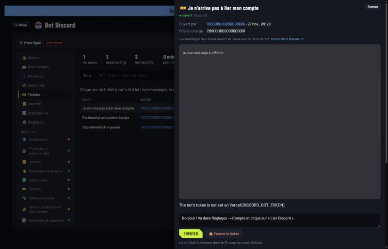
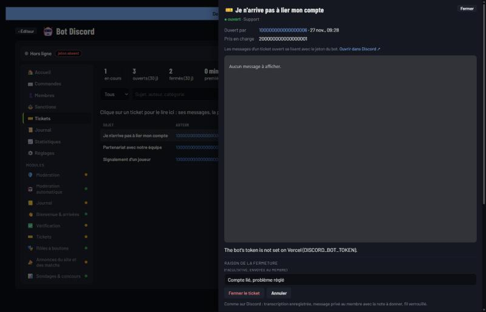
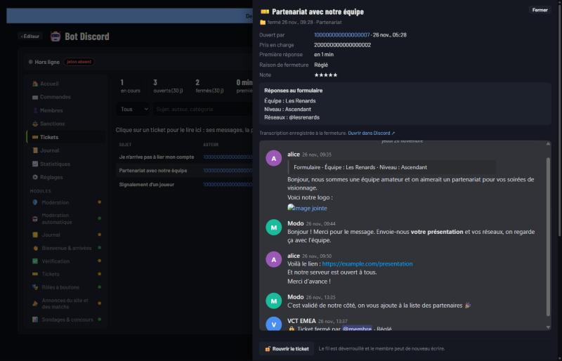

# Proposition : répondre, fermer et rouvrir un ticket depuis le tableau de bord

Branche `bot-tickets-actions`, partie de `main` (edab54e). Poussée seule : **rien n'est en ligne**.

## Ce qui change

Le panneau d'un ticket (page « Tickets », accueil, fiche d'un membre) ne sert plus seulement à lire : on peut aussi agir.

### Un ticket ouvert

- **Répondre** : on écrit sous la discussion, puis « Envoyer » (ou Ctrl + Entrée). Le bot publie la réponse dans le fil du ticket avec le nom de l'éditeur : « 💬 **Nom** · équipe (depuis le site) ». La réponse va aussi dans le journal du bot.
- **Fermer le ticket**, avec une raison facultative. C'est exactement la fermeture de Discord :
  - transcription enregistrée, et envoyée dans le salon du journal si c'est réglé ;
  - message privé au membre avec la raison et la note à donner ;
  - fil archivé et verrouillé.
  
  Dans le fil, le bot écrit « Ticket fermé par **Nom** (éditeur du site) » : un nom, pas une fausse mention Discord.

  
- **Actualisation en direct** : tant que le panneau est ouvert, les nouveaux messages arrivent toutes les 15 secondes. Elle se met en pause quand l'onglet est caché. Le panneau reste sur les derniers messages, sauf si on est remonté lire plus haut.

### Un ticket fermé

- **Rouvrir le ticket** : le fil est déverrouillé, le bot y écrit « Ticket rouvert par **Nom** (éditeur du site) », et le salon du journal est prévenu.

Après chaque action, la liste des tickets se met à jour.

## Testé

- **Nouveau test** (`tests/botticket.test.mjs`) : fermeture puis réouverture par un éditeur, avec un faux Discord. On vérifie le nom dans le fil sans fausse mention, le fil verrouillé, puis le ticket rouvert.
- **344 tests passent, build vert.**
- **Éditeur local** :
  - formulaire de réponse et Ctrl + Entrée ;
  - formulaire de fermeture et son « Annuler » ;
  - bouton « Rouvrir » sur un ticket fermé.
  
  Sans le jeton du bot, l'éditeur local affiche bien « Le jeton du bot n'est pas réglé… », et le texte tapé est gardé.

## Pas testé

- **L'envoi réel sur Discord** (réponse, fermeture, réouverture) et l'actualisation en direct : il faut le jeton du bot. Le chemin de fermeture est le même que celui de `/ticket close`, déjà en service.

Rien à refaire sur Discord : le bot a déjà les droits sur les fils de tickets.
