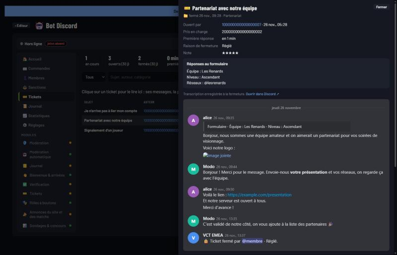

# Proposition : lire un ticket directement dans le tableau de bord

Branche `bot-tickets-vue`, partie de `main` (9803a8f). Poussée seule : **rien n'est en ligne**.

## Ce qui change

Dans la page « Tickets », **un clic sur un ticket** (sur la ligne, ou sur le bouton « Voir le ticket ») ouvre un panneau sur le côté. On y lit tout le ticket sans quitter la page.

- **En haut** : le sujet, l'état (ouvert, ou fermé à telle heure), la catégorie et la priorité.
- **Les détails** :
  - qui l'a ouvert et quand (le nom ouvre la fiche du membre) ;
  - qui l'a pris en charge ;
  - le temps avant la première réponse ;
  - la raison de fermeture et la note sur 5.
- **Les réponses au formulaire** d'ouverture, s'il y en a un.
- **La discussion, présentée comme sur Discord** :
  - les messages regroupés par jour et par auteur, avec l'avatar ;
  - le gras, l'italique, les liens cliquables ;
  - les @mentions remplacées par le nom du membre ;
  - les images jointes affichées, les autres fichiers en lien ;
  - le contenu des embeds (le formulaire, par exemple) ;
  - le panneau s'ouvre sur les derniers messages.
- **Un ticket ouvert** se lit **en direct** : ses messages sont lus sur Discord au moment du clic. Un ticket fermé se lit depuis la transcription enregistrée à la fermeture.
- Le lien **« Ouvrir dans Discord ↗ »** mène au fil du ticket.
- **Échap**, le bouton « Fermer » ou un clic à côté referment le panneau.

On peut aussi ouvrir un ticket depuis **l'accueil** (« Derniers tickets ») et depuis **la fiche d'un membre**.

Avant, il fallait un ticket fermé avec une transcription, et le texte brut s'affichait sous le tableau.

## Testé

- **2 nouveaux tests** (`tests/botticket.test.mjs`) :
  - une transcription faite par le bot se relit en messages : ordre, auteurs, retours à la ligne, fichiers joints, embeds ;
  - les messages lus en direct ont la même forme : avatar, marque « BOT », messages vides écartés.
- **343 tests passent, build vert.**
- **Éditeur local**, sur la copie de base avec un ticket fictif au vrai format du bot :
  - ouverture par un clic sur la ligne ;
  - affichage de la discussion et du formulaire ;
  - fermeture avec Échap ;
  - sur grand écran et sur téléphone, sans débordement.

## Pas testé

- **La lecture en direct d'un ticket ouvert**, et les noms et avatars des membres : il faut le jeton du bot, absent en local.
- **Les anciens tickets** : leur transcription utilise le même format. Ceux fermés sans transcription affichent « Aucune transcription n'a été enregistrée », et le bot tente quand même de relire leur fil sur Discord.

Rien à refaire sur Discord.
