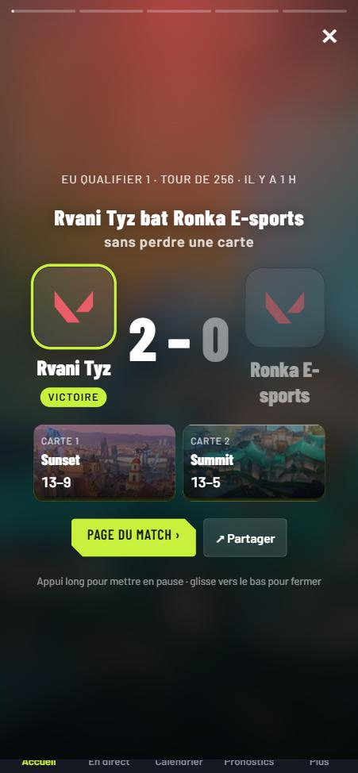
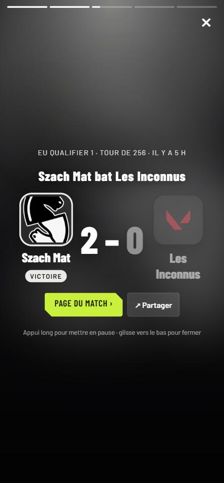
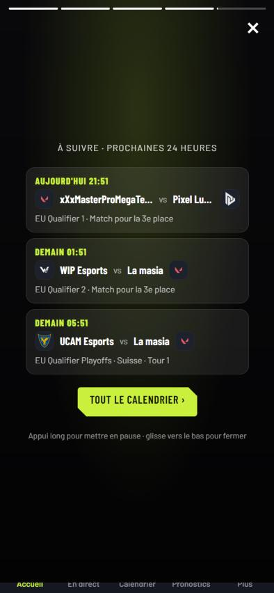

# Proposition : des stories plus complètes

Branche `stories-2`, partie de `bot-suite-5` (elle contient donc aussi les améliorations du bot pas encore en ligne). Poussée seule : **rien n'est en ligne**.

## Corrigé

- **Le score était grisé** : il prenait la transparence de l'équipe perdante. Le chiffre du gagnant est maintenant en blanc, celui du perdant atténué.
- **La barre du bas** (Accueil, En direct, Calendrier…) passait par-dessus la story : elle est maintenant cachée derrière.

## Ajouté (dans l'aperçu « stories2 », déjà activé sur le site)

- **Un titre** : « Rvani Tyz bat Ronka E-sports », avec « sans perdre une carte » pour un 2–0 ou « au bout de la carte décisive » pour un 2–1.
- **Le tour du match** dans la ligne du haut : « EU Qualifier 1 · Tour de 256 · il y a 1 h ».
- **Un fond même sans carte connue** : le logo du gagnant, en grand et flou, au lieu d'un fond vide.

  
- **Le MVP** quand il est connu, et **« ▶ Revoir le match »** (ou « Temps forts ») quand la VOD est connue.
- **« ↗ Partager »** : la feuille de partage du téléphone, ou une copie du lien sur ordinateur.
- **Une dernière story « À suivre »** (rond 📅 « À venir » au bout de la rangée) : les matchs des prochaines 24 heures, avec l'heure, les équipes et le tour, et un lien vers le calendrier. Elle reste à l'écran un peu plus longtemps que les autres.

  

## Testé

- **354 tests passent, build vert.**
- **Site local en taille téléphone** (copie de base, horaires de quelques matchs décalés pour avoir des résultats récents et des matchs à venir) :
  - une story avec cartes ;
  - une story sans carte (fond avec le logo) ;
  - la story « À suivre » ;
  - la barre du bas qui ne passe plus par-dessus.

## Pas testé

- Le bouton « Partager » sur un vrai téléphone (la feuille de partage ne s'ouvre que là).
- Le MVP et « Revoir le match » : aucun des matchs de la copie n'en avait.

**À savoir** : pour le match de ta capture (Eintracht Frankfurt – UCAM), les cartes manquaient parce que ses détails n'avaient pas encore été lus sur vlr.gg. C'est la lecture des matchs, suivie par l'autre session. Les stories montrent les cartes dès qu'elles sont connues.
